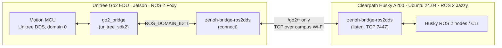

# Husky A200 × Unitree Go2: Multi-Robot Communication over ROS 2 + zenoh


Code and lab notes for making a **Clearpath Husky A200** and a **Unitree Go2 EDU** quadruped work together over campus Wi‑Fi.
The Husky reads the dog's odometry and sends it motion and posture commands, even though the two robots run **different ROS 2 distributions** (Jazzy ↔ Foxy) and the campus network **blocks multicast**, which normally breaks ROS 2 discovery.

> Husky bring-up, mapping and datasets live in [HuskyA200](https://github.com/greenaandblue/HuskyA200). This repository holds everything that involves **both robots**.

## Status

| Capability | Status |
|---|---|
| Go2 state → ROS 2 (`/go2/odom`, 50 Hz) via `unitree_sdk2` | ✅ Working on the Go2's Jetson |
| Go2 → Husky odometry over Wi‑Fi | ✅ `ros2 topic echo /go2/odom` on the Husky |
| Husky → Go2 `stand_up` / `stand_down` (`/go2/command`) | ✅ Verified on the real dog (2026-10-13) |
| Husky → Go2 velocity (`/go2/cmd_vel`) | 🟡 Reaches `go2_bridge`; walking test while standing is next |
| One-command startup (launch scripts) | ⬜ Currently 4 terminals |

## Architecture



Key design decisions:
- **zenoh instead of plain DDS discovery.** `zenoh-bridge-ros2dds` carries ROS 2 traffic over a single unicast TCP link. That works without multicast and across Foxy ↔ Jazzy. An allow-list keeps it to `/go2/*`.
- **Separate ROS domain on the Go2.** The dog's own services use DDS domain 0. Running our nodes there flooded `go2_bridge` with `bad_alloc`, so all of our ROS nodes on the Go2 use `ROS_DOMAIN_ID=1`.
- **Topics, not services, across robots.** ROS services don't cross the zenoh bridge with Fast DDS, so remote posture commands use the `/go2/command` topic.
- **SDK-first CycloneDDS.** `unitree_sdk2` bundles a newer CycloneDDS than ROS Foxy. `CMakeLists.txt` puts the SDK's headers first and sets an RPATH so the right `libddsc` loads at runtime.

## Repository layout

```
Husky-Go2-MultiRobot/
├── go2_bridge/                  ROS 2 package that runs on the Go2's Jetson (C++, unitree_sdk2)
│   ├── src/go2_bridge.cpp
│   └── config/go2_zenoh.json5   zenoh allow-list shared by both robots
├── go2_tools/go2_state_test/    SDK-only state reader, no ROS (skipped by colcon)
└── docs/                        Dated lab notes: setup, problems, root causes, results
```

## Quick start

**On the Go2** (ROS 2 Foxy, `unitree_sdk2` installed to `/opt/unitree_robotics`):

```bash
mkdir -p ~/go2_ws/src && cd ~/go2_ws/src
git clone https://github.com/greenaandblue/Husky-Go2-MultiRobot.git
cd ~/go2_ws && source /opt/ros/foxy/setup.bash
colcon build --packages-select go2_bridge --parallel-workers 1
```

**Daily startup.** Start the four terminals in the order A → C → B → D:

```bash
# A — Go2: go2_bridge
source /opt/ros/foxy/setup.bash && source ~/go2_ws/install/setup.bash
export RMW_IMPLEMENTATION=rmw_fastrtps_cpp ROS_DOMAIN_ID=1
ros2 run go2_bridge go2_bridge --ros-args -r __ns:=/go2 -p network_interface:=eth0 -p max_vx:=0.2

# C — Husky: zenoh bridge (listen)
source /opt/ros/jazzy/setup.bash && source /etc/clearpath/setup.bash
zenoh-bridge-ros2dds -c ~/go2_zenoh.json5 -l tcp/0.0.0.0:7447

# B — Go2: zenoh bridge (connect to the Husky)
source /opt/ros/foxy/setup.bash
export RMW_IMPLEMENTATION=rmw_fastrtps_cpp ROS_DOMAIN_ID=1
zenoh-bridge-ros2dds -c ~/go2_ws/src/Husky-Go2-MultiRobot/go2_bridge/config/go2_zenoh.json5 \
  -e tcp/<husky-ip>:7447

# D — Husky: test
ros2 topic echo /go2/odom --once
ros2 topic pub --once -w 1 /go2/command std_msgs/msg/String "{data: stand_up}"
ros2 topic pub --once -w 1 /go2/command std_msgs/msg/String "{data: stand_down}"
```

If the Husky prints `Waiting for at least 1 matching subscription(s)` forever, terminal B or A isn't running.

## `go2_bridge` interface

| Name | Type | Direction | Description |
|---|---|---|---|
| `/go2/odom` | `nav_msgs/Odometry` | out, 50 Hz | Pose from `rt/sportmodestate`, twist rotated into the body frame (`go2/odom` → `go2/base_link`) |
| `/go2/cmd_vel` | `geometry_msgs/Twist` | in | `SportClient::Move(vx, vy, wz)`, clamped by `max_vx` / `max_vy` / `max_wz`; stops after `cmd_timeout` without input |
| `/go2/command` | `std_msgs/String` | in | `stand_up` (StandUp → BalanceStand), `stand_down`, `recovery_stand`, `stop` |
| `/go2/stand_up`, `/stand_down`, `/stop` | `std_srvs/Trigger` | service | Local use on the Go2 only |

Parameters: `network_interface` (required, e.g. `eth0`), `max_vx` 0.5 m/s, `max_vy` 0.3 m/s, `max_wz` 0.8 rad/s, `cmd_timeout` 0.5 s, `odom_frame`, `base_frame`, `odom_rate` 50 Hz.

## Documentation

| Document | Contents |
|---|---|
| [docs/2026-10-12_husky_go2_comm_summary.md](docs/2026-10-12_husky_go2_comm_summary.md) | One-page progress summary (EN + 中文), updated 2026-10-13 |
| [docs/2026-10-12_husky_go2_comm_detailed.md](docs/2026-10-12_husky_go2_comm_detailed.md) | Full setup log: system configuration, one-time setup on both robots, chronological problems / root causes / fixes, troubleshooting table |

## Adding new work

This repository is the home for all future Husky ↔ Go2 work. Conventions:

| What | Where |
|---|---|
| New ROS 2 packages | Top level, one folder per package (e.g. `go2_bridge/`) |
| Launch / startup scripts | `scripts/` |
| Shared configs used by both robots | Inside the package that owns them, or `config/` |
| Lab notes and test results | `docs/YYYY-MM-DD_<topic>.md`; images in `docs/images/` |
| Tools not built by colcon | `go2_tools/` (has `COLCON_IGNORE`) |

## Roadmap

- [ ] Walking test: `/go2/cmd_vel` from the Husky while the dog is standing
- [ ] Measure Wi‑Fi gaps on `/go2/cmd_vel`; tune `cmd_timeout` (≈1.0 s)
- [ ] Launch scripts for both robots to replace the 4-terminal startup
- [ ] Persistent Go2 network fixes (`ipv4.never-default`, `power_save off`) and NTP time sync
- [ ] Verify the `/go2/odom` twist frame; relate `go2/odom` to the Husky's TF tree for joint tasks
- [ ] Restrict the zenoh port (currently open without authentication)

## Maintainer

**Huihang Liu** · Computer Engineering, Penn State · [@greenaandblue](https://github.com/greenaandblue)
